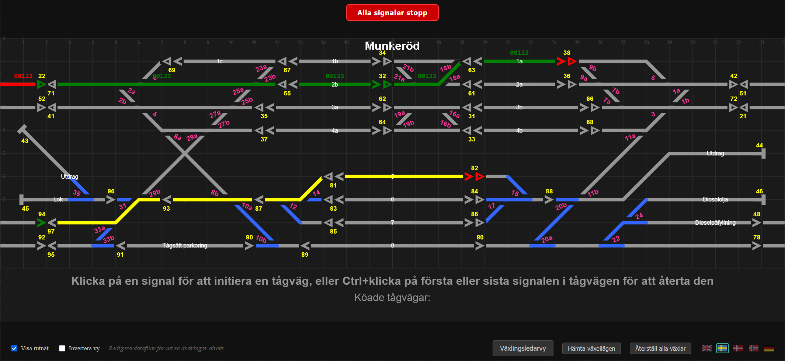

# Yard Control Application

A .NET Blazor Server application for controlling model train yard points (turnouts) via either the **LocoNet** protocol over a serial interface or a **Roco/Fleischmann Z21** command station over UDP.
It provides a graphical web UI with interactive signal-based train route setting, as well as numeric keypad input for hands-free operation.

The application supports individual point control, train routes between signals with automatic route derivation from topology, point locking to prevent conflicting movements, signal control, and real-time position feedback from the command station.

## Features

### Operations
- **Main and shunting routes** — Set main train routes or shunting routes between signals. Main routes are highlighted in green; shunting routes in yellow (EBICOS palette, TRVINFRA-00305 §6.2.1). Shunting routes only clear signals that have a dwarf part — a main signal on the route stays at stop — skip destination signal go-aspects, and release locks immediately — matching real railway shunting operations. A route that starts at a shunting dwarf signal (`d`) is always set as a shunting route, even when a main route was requested, since such a signal cannot authorise a train movement.
- **Automatic route derivation** — Just specify the from and to signals; the application finds the shortest path through the topology and determines the required point positions automatically.
- **Train route queueing** — When a route conflicts with an active route, it is automatically queued and executed as soon as the blocking route is cleared. Queued routes are displayed in the UI and can be cancelled before they execute.
- **Clear vs cancel semantics** — Clearing a route (`/`) advances the train number to the detection stretch in front of the destination signal, confirming the train has arrived; cancelling (`ESC`) removes the train numbers instead. Both hold the point locks for the configured safety delay (`LockReleaseDelay`) before releasing them. The distinction between the two commands is what happens to the train number, not to the locks. Locks are released without the delay in two cases only: a shunting route, and a route ended by reporting the train at its final signal (`=[trainnumber]⏎`, `[signal]=⏎`), where the train is known to be standing clear of the points.
- **Signal control** — Signals are set to go/stop automatically when routes are set or cleared, with hardware integration via LocoNet accessory addresses. Five signal types are supported: OutboundMain, InboundMain, MainDwarf, ShuntingDwarf, and Hidden. A sixth object, the buffer stop, is declared the same way and closes a dead-end track: a movement can end there but never start there, and it shows no proceed aspect.
- **Two views, two roles** — A station is worked from a *dispatcher view* and, when a shunting yard master is on duty, a *shunter view*. Both show the whole yard; what differs is what may be touched. While a shunting area is released, its points and the routes inside it are the shunter's alone and the dispatcher is refused them; everything outside stays the dispatcher's. The shunter view is meant for a tablet, so every operation is a tap: throwing a point, setting a route, clearing one, and asking for or handing back an area.
- **Train number labels** — A train number stands on a *detection stretch*, the piece of track a train can be on, and is written centred above it in a monospaced five-digit field. With no hardware reporting where a train is, its position is deduced from the commands given: it is accepted from the previous station onto the run in from the layout edge, moves up the route as the operator confirms arrival, steps out onto the run to the edge when it departs, and leaves the diagram when the next station reports it arrived. EBICOS repeats the number the length of the route the train is running, so every piece of track shows which movement it has been given to.

### Configuration and options
- **Single file configuration** — Define your entire station (topology, points, signals, routes, translations) in a single text file with a human-readable format.
- **Multiple station support** — Configure several stations and switch between them at runtime from the UI.
- **Live configuration reload** — Edit data files while the application is running; changes are detected and applied automatically.
- **Localisation** — UI and track labels available in English, Swedish, Danish, Norwegian, and German.
- **Choice of command station** — Drive accessories over LocoNet (serial) or via a Roco/Fleischmann Z21 over UDP. Point and signal feedback work identically on both.



## Installation

### Download a release

Download the archive for your platform from the [GitHub Releases](https://github.com/tellurianinteractive/Tellurian.Trains.YardControl.Application/releases) page:

| Platform | Archive |
|----------|---------|
| Windows x64 | `YardControlApplication-vX.X.X-win-x64.zip` |
| Windows ARM64 | `YardControlApplication-vX.X.X-win-arm64.zip` |
| Linux x64 | `YardControlApplication-vX.X.X-linux-x64.tar.gz` |
| Linux ARM 32-bit | `YardControlApplication-vX.X.X-linux-arm.tar.gz` |
| Linux ARM 64-bit | `YardControlApplication-vX.X.X-linux-arm64.tar.gz` |

The releases are self-contained — no .NET runtime installation is required.

### Install and run

**Windows:**

1. Extract the zip archive to a folder of your choice (e.g., `C:\YardControl`).
2. Connect your command station (LocoNet interface via USB, or Z21 via Ethernet).
3. Edit `appsettings.json` to configure your stations and command station — see the [Command station](#command-station) section for details. A minimal LocoNet-over-serial configuration:
   ```json
   {
     "Stations": [
       { "Name": "Munkeröd", "DataFolder": "Data\\Munkeröd.txt" }
     ],
     "CommandStation": {
       "Type": "Serial",
       "SerialPort": { "PortName": "COM5", "BaudRate": 57600 }
     }
   }
   ```
4. Run `YardController.Web.exe`.
5. Open `http://localhost:5180` in a browser, or one of the network addresses the application logs at startup — see [Network access](#network-access).

**Linux:**

1. Extract the archive:
   ```bash
   tar -xzf YardControlApplication-vX.X.X-linux-x64.tar.gz -C /opt/yardcontrol
   ```
2. Make the executable runnable:
   ```bash
   chmod +x /opt/yardcontrol/YardController.Web
   ```
3. Connect your command station (LocoNet interface via USB, or Z21 via Ethernet).
4. Edit `appsettings.json` to configure your stations and command station — see the [Command station](#command-station) section for details. A minimal LocoNet-over-serial configuration:
   ```json
   {
     "Stations": [
       { "Name": "Munkeröd", "DataFolder": "Data/Munkeröd.txt" }
     ],
     "CommandStation": {
       "Type": "Serial",
       "SerialPort": { "PortName": "/dev/ttyUSB0", "BaudRate": 57600 }
     }
   }
   ```
   The serial port is typically `/dev/ttyUSB0` for USB-to-serial adapters or `/dev/ttyACM0` for devices with built-in USB. Run `ls /dev/tty*` to find the correct device name.
5. Run the application:
   ```bash
   /opt/yardcontrol/YardController.Web
   ```
6. Open `http://localhost:5180` in a browser, or one of the network addresses the application logs at startup — see [Network access](#network-access).

### Network access

The application listens on **port 5180 on every network interface**, so the yard can be worked from a
second computer or from a tablet on the same local network — one operator at the dispatcher's view,
another at the shunter's. Open `http://<the computer's address>:5180`; the addresses the application
answers on are written to the log when it starts:

```
info: YardController.Web[0]
      Open the yard control in a browser at http://localhost:5180, http://192.168.1.2:5180
```

Only plain HTTP is served. A certificate for HTTPS would have to be valid for whatever address the
operator types, which on a layout network is an address handed out by the router's DHCP, so the
browser would warn about it on every device. The application is meant for a closed layout network,
never for the open internet.

The port and the interfaces are set in `appsettings.json`:

```json
{
  "Kestrel": {
    "Endpoints": {
      "Http": { "Url": "http://0.0.0.0:5180" }
    }
  }
}
```

`0.0.0.0` means *every network interface*. Replace it with `localhost` to keep the application to the
computer it runs on.

The first start on **Windows** raises a Windows Defender Firewall prompt — allow the application on
*private networks*. If the prompt was dismissed, the rule can be added from an elevated PowerShell:

```powershell
New-NetFirewallRule -DisplayName "Yard Control" -Direction Inbound -Protocol TCP -LocalPort 5180 -Profile Private -Action Allow
```

On **Linux**, open the port in the firewall, for example `sudo ufw allow 5180/tcp`.

### Station data files

Copy your station `.txt` files into the `Data` folder next to the executable and reference them in `appsettings.json`. See the [Configuration](#configuration) section for the file format. The application watches the data files for changes, so you can edit them while the application is running.

## Usage

### Web Interface

The browser-based GUI displays the full yard topology as an interactive SVG diagram:

- **Signals** follow the EBICOS symbol set: a chevron is a dwarf signal, a pierced triangle is a main signal, and a main dwarf signal draws both with the dwarf part on the approach side. The symbol sits on the track line, breaks it, and points in the direction of travel.
- **Signal colour is state, not type** — grey at stop (the normal state), green for proceed, red for the destination signal of an active route, magenta while a route is releasing. On a main dwarf signal a shunting route shows a green dwarf part against a grey main part, at the origin signal and at every signal the route passes through.
- **Signal numbers** are yellow, placed above the symbol for a signal facing right and below it for one facing left.
- **Points** display their current position with colour coding (straight/diverging/unknown); point labels are magenta.
- **Active main routes** are highlighted in green along the track path; **shunting routes** in yellow; inactive track is grey; routes being cancelled are shown in magenta (locks still held).
- **Train numbers** appear as bare monospaced text centred above the detection stretch they stand on, padded with leading zeroes to five digits, and repeated along every stretch of the route the train is running. Each copy wears the colour of the stretch beneath it: red where the train actually stands (that stretch is occupied), otherwise the colour of the route.
- **Labels** identify tracks, signals, and points.

#### Working the diagram by hand

Everything can be done by pointing, so a tablet needs no keyboard:

- **Set a route** — tap a signal to select the *from* signal; a blinking green flag appears beneath it, marking the stored start point. Tap a second signal for the *to* signal. The route is set, the points are moved and locked, and the from signal turns green.
- **Clear a route** — tap the signal the route starts from. The status line asks for confirmation; tap the same signal again to clear it. The question lapses after a few seconds, so a stray tap cannot arm it.
- **Throw a point** — tap its label. The label carries a hit area wider than the text so a finger finds it, and each tap throws the point to the other position.
- **Give an end signal go** — tap the destination signal of an active route that no other signal follows, and it toggles between stop and go. Those are the signals a movement can only end at, so a tap there cannot mean anything else. Whether a signal is followed is read from the route table: a signal that never starts a route and never lies inside one has nothing beyond it.

At the desk, the keyboard shortcuts remain: CTRL+click on a green signal cancels its route, and Shift+click toggles any signal between stop and go.

#### Dispatcher view

The dispatcher view is at `/` (default station) or `/{station}`, and works the whole yard. Above the diagram is an **All Signals Stop** emergency button that immediately sets all green signals to red. It is the only view that takes keyboard input.

The footer provides:
- **Show Grid** checkbox to toggle coordinate grid overlay (useful for editing topology files).
- **Shunter view** button to switch roles — handy for testing, or for letting the yard master run the whole station while the dispatcher steps away.
- **Query Point States** button to request current positions from hardware (or simulate random positions in development mode).
- **Reset All Points** button to set all unlocked points to straight position (locked points are skipped).
- **Language selector** to switch the UI language.

When a shunter asks for an area, its name appears in blinking blue below the diagram until the dispatcher answers with `A[area]+`.

#### Shunter view

The shunter view is at `/{station}/shunter`, and shows everything that happens in the yard while permitting only what belongs to the released shunting areas. It takes no keyboard input at all.

Along the top is one chip per shunting area, with a button to **ask for** an area, to **withdraw** the request while it is still unanswered, or to **hand back** an area that has been released. Only the dispatcher can release an area; the shunter can always hand one back.

Inside a released area the shunter may throw the area's points and set routes that stay within the released areas — a route may cross from one released area into another. Such a route is always set as a shunting route, whatever its signals would otherwise allow. Everything else is visible but refused, with the reason in the status line.

### Numeric Keypad

A numeric keypad is required for full operation — it enables hands-free control of all yard functions. Either a wired USB keypad or a wireless keypad works; a wireless keypad is notably easier to move around with during operations.

#### Point Commands

| Command | Description |
|---------|-------------|
| `[number]+` | Set point to straight (e.g., `1+`) |
| `[number]-` | Set point to diverging (e.g., `1-`) |

A point number can represent a single point or multiple coupled points (e.g., opposing crossover points) that move together.

#### Signal Commands

| Command | Description |
|---------|-------------|
| `S[signal]+` | Give the signal go (e.g., `S22+`) |
| `S[signal]-` | Put the signal to stop (e.g., `S22-`) |

This is the keypad's form of what shift-clicking a signal on the diagram does, and it asks the same
of the interlocking: nothing. The signal is set as told, so a signal no route covers can be worked
too. A buffer stop is refused go — §6.2.9 gives it no proceed colour. Signals are the dispatcher's
alone.

#### Train Route Commands

| Command | Description |
|---------|-------------|
| `[from][to]⏎` | Set main train route (e.g., `2131⏎` sets path from signal 21 to 31). A route starting at a shunting dwarf signal is always set as a shunting route |
| `[from][to]*` | Set shunting route |
| `[from].[to]⏎` | When signal numbers have different digit counts, use `.` as divider (e.g., `121.33⏎`) |
| `[from].[via].[to]⏎` | Multi-signal route (e.g., `21.31.35⏎`) |
| `[signal]/` | Clear all routes up to a signal (e.g., `31/`) |
| `//` | Clear all train routes and release all locks. Train numbers remain visible until you advance them with the train-number commands below |
| `ESC ESC` | Cancel all train routes, release all locks, and remove all train numbers |
| `**` | Set all signals to stop |
| `==` | Set all unlocked points to straight |

**Note:** Clearing up to a signal can be used to manually confirm that a train has reached its destination signal, releasing the locks on points used in the route. This is useful when occupancy detection is not available.

#### Train Number Commands

Train numbers stay where the train physically is, standing on the detection stretch that leads up
to a signal rather than at the signal itself. When a route is set with `=[trainnumber]`, the number
appears on the stretch in front of the **origin** (from) signal — for a train accepted from the
previous station, the run in from the layout edge. As the train moves through the yard, advance the
number with one of the arrival commands.

| Command | Description |
|---------|-------------|
| `[from][to]=[trainnumber]⏎` | Set route and put the train number on the stretch in front of the origin signal (e.g., `2131=1234⏎`) |
| `[from].[to]=[trainnumber]⏎` | Same with `.` divider (e.g., `121.33=1234⏎`) |
| `[signal]=[trainnumber]⏎` | Put a train number that is not running a route on the stretch in front of a signal (e.g., `21=1234⏎`) |
| `[signal]/` | Clear the route up to that signal **and** move the train number up to the stretch in front of it — confirms arrival |
| `[signal]=⏎` | Move the train number up to the stretch in front of that signal. The signal must lie on the route the train is running and ahead of where it stands. An intermediate signal leaves the route standing; the route's own final signal confirms arrival and clears it |
| `=[trainnumber]⏎` | Advance that train number one step: to the end of the route it is running, then out onto the run between the last signal and the layout edge (departed), and finally off the diagram (the next station reports it arrived) |

A route is set for one movement, so reporting the train at the end of it clears the route — with
`[signal]/`, with `[signal]=⏎` up to the route's own final signal, or with `=[trainnumber]⏎`. The
same happens when the train is reported departed: the outbound route it left on is cleared, and the
number stands on the run between the last signal and the layout edge, which is drawn occupied.

Where the track branches, several stretches lead up to the same signal. The route the train is
running decides which one it stands on; without a route the shortest approach stretch is taken —
the track alongside the signal rather than a run across the whole throat.

Cancelling a route with `ESC` removes the train number.

The `⏎` symbol throughout these tables is the **Enter** key on the numpad.

#### Turntable Commands

| Command | Description |
|---------|-------------|
| `+[track number]⏎` | Move turntable to the specified track position |

#### Shunting Area Commands

A shunting area is a named group of points that can be handed over to a shunter as a unit. While an
area is released, its points are drawn in EBICOS blue to show that the shunter — not the interlocking
— decides where they stand. The area's flank protection points are set and held locked for as long as
the area is released, so nothing can run into it; they stay grey, because they are not the shunter's
to move.

| Command | Description |
|---------|-------------|
| `A[area]+` | Release the area to a shunter (e.g., `A2+`) |
| `A[area]-` | Take the area back under the interlocking's control |

A release is refused while any of the area's points is locked by an active train route. Taking an
area back clears any route still standing inside it, so it returns to the interlocking in a known
state. Areas are declared in the station file's `[ShuntingAreas]` section.

While an area is released, its points belong to the shunter: the dispatcher is refused both a direct
point command and any route that would use one of them, and so is a point coupled to one of them by a
slave cascade, since it cannot move independently. `A[area]+` is the dispatcher's command alone —
a shunter can only ask for an area, and hand it back with `A[area]-`.

#### Other

| Command | Description |
|---------|-------------|
| `⌫` | Clear current input buffer |
| `+-` | Reload configuration |

## Configuration

Configuration files are located in `YardController.Web/Data/` (paths can be changed in `appsettings.json`). Files are watched for changes and automatically reloaded.

Multiple stations can be configured in `appsettings.json`:

```json
{
  "Stations": [
    { "Name": "Munkeröd", "DataFolder": "Data\\Munkeröd.txt" },
    { "Name": "Steinsnes", "DataFolder": "Data\\Steinsnes.txt" }
  ]
}
```

Each station is configured as a single text file with named sections. This keeps all station data together and enables automatic route derivation.

```
Munkeröd

[Settings]
LockOffset:1000
LockReleaseDelay:30

[Tracks]
1.1-1.2-1.3-1.4                         ' track segments (left-to-right)

[Points]
2.3(1a>)-2.4  @840a,843b                ' forward point with LocoNet address
2.5(<2)-2.6  @842                        ' backward point
4.7(8a>)-7.10(<8b)  @-809a,812b   &+:10+   ' single-slip half: setting 8 to + also forces 10 to +
7.10(10a>)-9.12(<10b)  @-813a,822b   &-:8- ' the other half: setting 10 to - also forces 8 to -

[Signals]
1.1:21>:u  @900                          ' outbound main signal driving right
1.4:<31:i  @901;951                      ' inbound main signal with feedback address
2.1:<47s                                 ' buffer stop at the end of a dead-end track

[Routes]
21-31                                    ' auto-derived from topology
21-31:x25+                               ' auto-derived + explicit flank protection
21-35:21.31.35                           ' composite route via intermediate signal

[Labels]
1.1[Goods track]1.4

[Gaps]
2.3|2.4                                  ' occupancy gap on a link

[OccupancySections]
1:2.0,2.2  @901                          ' track detection stretch with feedback address
2:2.2,2.4                                ' stretch not wired to a detector

[Translations]
en;sv;da;nb;de
Track;Spår;Spor;Spor;Gleis
Goods track;Godsspår;Godsspor;Godsspor;Güterspur

[Turntable]
Tracks:1-17
Offset:196
```

Comments start with a single quote (`'`). Section names are case-insensitive.

**Route auto-derivation:** When a route line contains only signal numbers (e.g., `21-31` without a colon), the application uses the topology graph to find the shortest path between the signals and automatically determines which points need to be set to straight or diverging. You can also specify only flank protection points (prefixed with `x`) and let the on-route points be auto-derived.

**Slave clauses (point coupling):** Single-slip switches (and similar arrangements where two configured points are mechanically coupled) can declare that setting one position automatically sets another point. Append one or more whitespace-separated `&<masterPos>:<slave><slavePos>[,<slave><slavePos>...]` clauses after the address spec. For example, `&-:8-` on point `10` means *"when 10 is set to diverging, also set 8 to diverging"*. The cascade applies both to direct keypad commands and to routes that include the master point. If a route or a keypad command would force a single point to two different positions (its own master plus a contradictory slave), it is rejected at load or input time.

**Signal types:** `u`=OutboundMain, `i`=InboundMain, `h`=MainDwarf, `d`=ShuntingDwarf, `x`=Hidden, `s`=BufferStop. The colon before the type marker may be left out, so `2.1:<47s` and `2.1:<47:s` are the same signal.

**Track detection stretches:** A stretch (*spårledning*) is an isolated piece of track the hardware can report as occupied. It is declared as `number:from,to  @address`, where the two coordinates are its ends and the address is the detector's feedback address. A stretch has no direction — it detects a movement coming from either end — and the address may be left out while it is not wired to anything. When a station file has no `[OccupancySections]` section at all, the application deduces a first set from the topology and writes it back to the file, so the stretches only need their addresses filled in. The ends it uses are the signal coordinates and the coordinates where track leaves the layout; two signals standing back to back on one coordinate count as one end. Stretches overlap where the track branches, because a train on a throat is on every stretch that runs over it. A file that already declares the section — even an empty one — is left alone.

**Buffer stops:** A buffer stop (*stoppbock*, TRVINFRA-00305 §6.2.9) is declared like a signal but stands for the physical end of a dead-end track, so it can only be placed at a track end that is not at the edge of the layout, where the track leaves the station instead of ending. Its direction must be the direction of the track leading up to it, since the symbol is drawn facing that way, and it turns with that track so it stays square to the rails on a diagonal as well as on the level. It can only be the *destination* of a movement, never its start, and a route ending at one is always a shunting route.

## Translations

The application UI is currently localised in English, Swedish, Danish, Norwegian, and German.

Track labels in the yard diagram (e.g., "Goods track", "Headshunt") can be translated per language. Translations are defined in the `[Translations]` section of the station file.

## Signals

When a train route is set, the from signal and any intermediate signals are set to go (green). When a route is cleared, those signals are set back to stop (red), unless they are still needed by another active route.

The `//` command (cancel all routes) also sets all route signals to stop before releasing locks. The `**` command sets all signals to stop regardless of route state. A single signal is worked with `S[signal]+` (go) and `S[signal]-` (stop), which is the keypad's form of shift-clicking a signal on the diagram.

Detailed signal aspects are typically implemented in the yard's internal control system and are not part of this application.

## Occupation Feedback

Track detection stretches declared in the station file's `[OccupancySections]` section are drawn red when the hardware reports them occupied. Red is TRVINFRA-00305 §6.2.1 priority 2, above every route colour, so where a train stands the diagram says so before it says what the track was set for. Occupancy arrives as detector notifications — LocoNet `OPC_INPUT_REP` over serial, or the Z21's LocoNet and CAN detector broadcasts — and the feedback address is mapped back to the stretches declared on it. Several stretches may share one address: where the track branches they are the ways through a single piece of isolated rail, and it is the points that tell them apart.

Because stretches overlap at the points, a detector there cannot say which way through them the movement went, and showing every overlapping stretch would light the whole throat. The points can say, though: a point standing straight is turned away from its diverging arm, and that is what tells one stretch through a throat from the others sharing its rails. So an occupied stretch is drawn where its points still connect it — whole where they are set for it end to end, and otherwise only the part a movement could still have reached, the arm they are turned away from and whatever it cuts off dropping out. This holds whether or not a route is set over the track, and needs nothing switched on to work. A point whose position is not known is turned away from nothing, because not knowing where a point stands must never hide a train.

In development there is no detector to report anything, so clicking a stretch in the diagram reports it occupied or free instead. Since stretches overlap, the click reports the shortest stretch covering the track under the pointer that the points still connect end to end — the same stretch the diagram then draws.

Automatically resetting a train route when the train reaches the final signal is still to come.

## Command station

The application talks to either a LocoNet command station over a serial interface or a Roco/Fleischmann Z21 (or Z21-compatible, e.g. TAMS mc², YaMoRC YD7010/YD7001) over UDP. Switching is done by the `CommandStation:Type` setting in `appsettings.json`:

```json
"CommandStation": {
  "Type": "Serial",
  "SerialPort": { "PortName": "COM5", "BaudRate": 57600 },
  "Z21": { "Address": "192.168.0.111", "CommandPort": 21105, "FeedbackPort": 21106 }
}
```

| `Type` | Transport | Settings used |
|---|---|---|
| `Serial` | LocoNet over a USB/serial interface (LocoBuffer-USB, PR3, PR4, etc.) | `SerialPort` |
| `Z21` | Z21 LAN UDP protocol | `Z21` |

Only the settings block matching the selected `Type` is used; the other is ignored but kept as a template.

### Z21 notes

When running against a Z21, the application sends accessory commands as native XpressNet (`LAN_X_SET_TURNOUT`) and subscribes to `RunningAndSwitching` broadcasts to receive turnout state changes, plus `OccupiedStretch` for the detector broadcasts the track detection stretches are read from. This makes the yard app fully interoperable with the Z21 App, WLANMaus, and other XpressNet clients — point changes from any client are visible in all others. The Z21 bridges XpressNet accessory commands to its internal LocoNet bus, so LocoNet-connected accessory decoders still receive commands.

UDP port 21106 (or whichever port is configured as `FeedbackPort`) must be allowed through Windows Firewall for feedback to work.

If you run multiple yards from separate Z21 units, each instance of the application subscribes independently to its own Z21.

## Accessory and feedback communication

### Setting Points

Point commands are sent as protocol-agnostic accessory commands through the Tellurian communications adapter layer. Each point number maps to one or more hardware accessory addresses configured in the station file. A negative address inverts the direction: `Closed` becomes `Thrown` and vice versa.

When a train route is set, the application sends commands for all points in the route in sequence.

### Point Locking

When `LockOffset` is configured, hardware point locking is supported. Setting a train route:

1. Sends turnout commands to move points to the correct positions.
2. Sends lock commands (`Closed`) to each point's lock address (*address + offset*).

When a train route is torn down by command — cleared with `/` or cancelled with `ESC`, one route or the whole yard:

1. Signals are immediately set to stop.
2. The route is shown in magenta on the UI, indicating that locks are still held.
3. After a configurable delay, unlock commands (`Thrown`) are sent to the lock addresses and the route is fully cleared.

This two-phase teardown mirrors real railway operations where point locks are held for a safety period after signal clearance. The delay is configured in the station file (`LockReleaseDelay` under `[Settings]`). In development mode, the delay is always 5 seconds.

The delay is skipped when the route ends because the train was reported at its final signal (`=[trainnumber]⏎`, `[signal]=⏎`): the train is then standing clear of the points, so the unlock commands go out with the stop signals. Shunting routes also release immediately, whatever ends them.

This feature is designed for **Möllehem** switch decoders that support individual point locks via a parallel address range. When a point is locked, it cannot be altered via LocoNet, XpressNet, or buttons connected to the decoder.

Logical locking is always active regardless of hardware support: the application prevents conflicting train routes from being set when the same point would need different positions.

### Position Feedback

The application listens for accessory state notifications from the command station to track the actual position of each point. When a notification is received, the hardware address is mapped back to the corresponding point number and the position is updated in real-time on the UI.

Point changes made from other sources — the Z21 App, WLANMaus, handsets on the LocoNet bus, or other throttles — are reflected in the yard display in real time.

For paired points with sub-point suffixes (e.g., `1a`, `1b`), each sub-point tracks its position independently from the same or different hardware addresses.
